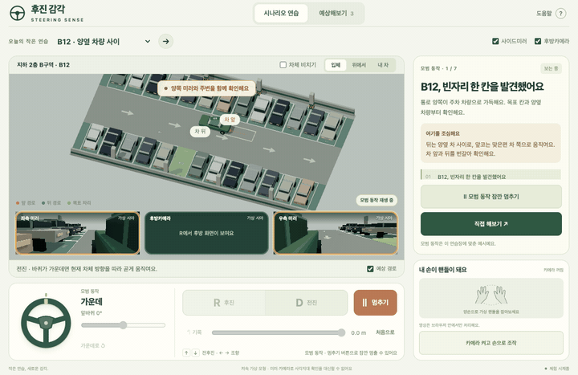
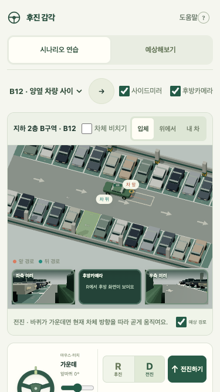

# 후진 감각 · Steering Sense

[](https://github.com/khjn81/steering-sense-lab/actions/workflows/ci.yml)

핸들을 돌렸을 때 차의 앞과 뒤가 어떻게 움직이는지 비교하는 브라우저 연습장입니다. 아파트 지하주차장 세 가지 상황, 단계별 모범 동작, 가상 미러, 기록 되감기와 예측 퀴즈를 만들었습니다. 마우스·키보드·터치를 지원하고, 로컬 MediaPipe 모델로 손 조작도 실험할 수 있습니다.



[주차장 스크린샷](docs/garage-desktop.png)

## 실행

Python 3로 실행합니다. 앱 사용에는 API 키나 계정이 필요 없습니다.

```sh
python3 serve.py
```

**http://127.0.0.1:8768/** 를 엽니다. Mac에서는 `start.command`도 사용할 수 있습니다. 서버는 `dist/`만 loopback 주소로 제공합니다. 카메라는 localhost 또는 HTTPS에서 사용합니다.

Three.js, MediaPipe, WASM과 모델을 저장소에 포함했습니다. 설치 후 앱을 실행하는 데 외부 CDN이 필요하지 않습니다. 배포 서비스를 이용한다면 서버의 MIME·CSP·카메라 정책도 함께 적용해야 합니다.

## 해보기

1. `B12 · 양옆 차량 사이`, `B14 · 기둥 옆 자리`, `B12 · 통로 차량 기다리기` 중 하나를 고릅니다.
2. **모범 동작 보기**로 단계와 주의 지점을 확인하고, **직접 해보기**로 돌아옵니다.
3. R/D 버튼으로 출발하고 핸들·슬라이더로 조향합니다. 키보드는 `↑/W`, `↓/S`를 누르는 동안 움직이며, `←/→`로 조향합니다. `Escape`는 즉시 정지입니다.
4. 이동 기록으로 되감거나 재생합니다. 최근 움직임을 보관하고 **처음으로**로 기록을 새로 시작합니다.
5. 손 조작은 카메라 버튼을 누른 뒤 양손을 잠깐 고정해 보정합니다. 추적을 잃으면 멈추며, 손이 돌아와도 직접 다시 출발해야 합니다.

입체·위에서·내 차 시점과 미러·후방 시야를 비교할 수 있습니다. 3D를 사용할 수 없거나 사용 중 잃으면 2D로 전환합니다. 작은 화면에서는 설명과 카메라 영역을 스크롤로 볼 수 있습니다.

<details><summary>모바일 화면</summary>



</details>

## 개발·검증

검사 도구에는 Node.js 22가 필요합니다.

```sh
npm ci --ignore-scripts
npx playwright install chromium webkit
npm run assets:check
npm run format:check
npm run verify
npm run check:clean
```

`dist/`에는 직접 수정하는 앱 원본이 있습니다. 자동 빌드 결과만 담은 폴더가 아닙니다.

| 위치                                   | 역할                                        |
| -------------------------------------- | ------------------------------------------- |
| `dist/app.mjs`                         | 조작·시나리오·퀴즈·기록·중단 및 복구        |
| `dist/simulation.mjs`, `scenarios.mjs` | 저속 조향 모형·주차 배치·접촉 및 목표 판정  |
| `dist/scene.mjs`                       | 3D·가상 미러·2D 복구·그리기 자원 관리       |
| `dist/hand-*.mjs`, `hand-worker.js`    | 카메라·보정·추적·로컬 모델 추론             |
| `tests/`, `e2e/`, `release-checks/`    | 물리·경계·자원·실제 브라우저·모범 주차 검사 |
| `quality/`                             | 고정 루브릭·개선 요약·검증한 의존성 바이트  |

20회 개선의 근거와 실패 사례는 [품질 기록](docs/quality.md)에 정리합니다. 앱 코드의 [MIT 라이선스](LICENSE)와 [외부 구성요소 표기](THIRD_PARTY_NOTICES.md)를 함께 확인하세요.

## 모형의 범위

축간 거리 2.7m, 트랙 1.54m, 예시 조향비 12:1, 속도 0.8m/s인 저속 기구학 모형입니다. 주차장·차량·미러는 가상이며 실제 차종의 시야나 제동 거리를 재현하지 않습니다. Meta AI 코칭은 연결하지 않았습니다.

자동 검사는 브라우저 조작, 합성 영상·손 좌표의 경계 상태, 실제 모델의 빈 영상 추론을 확인합니다. 실제 사람의 손으로 연속 조작하는 품질, 실기기 성능, 학습 효과와 실제 운전 능력은 아직 검증하지 않았습니다.
